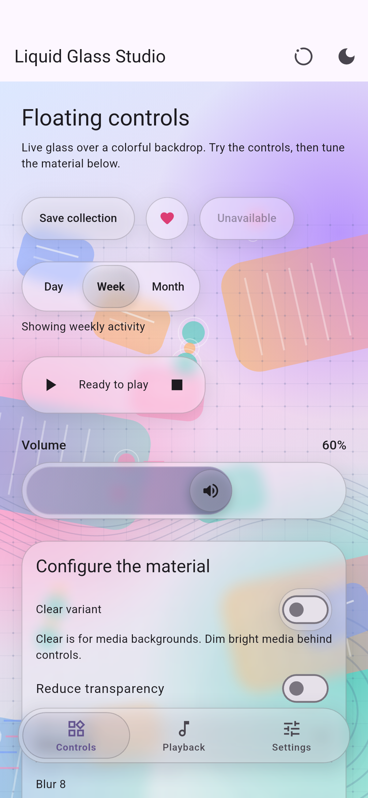
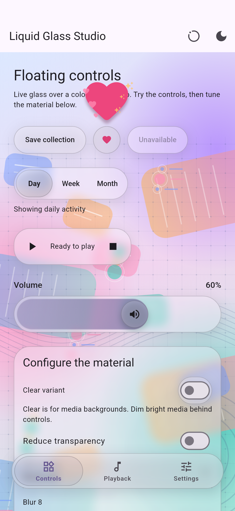

# liquid_ui_components

Configurable liquid glass controls for Flutter: optical surfaces, buttons,
segmented selectors, sliders, switches, toolbars and bottom navigation.

[pub.dev](https://pub.dev/packages/liquid_ui_components) ·
[Source](https://github.com/veha2309/liquid_ui_components) ·
[Issues](https://github.com/veha2309/liquid_ui_components/issues) ·
[Interactive example](example/lib/main.dart)

 

## Contents

- [Features and requirements](#features-and-requirements)
- [Choosing a rendering mode](#choosing-a-rendering-mode)
- [Understanding the visual controls](#understanding-the-visual-controls)
- [Installation](#installation)
- [Runnable quick start](#runnable-quick-start)
- [Components and usage](#components-and-usage)
  - [Liquid blending and draggable droplets](#liquid-blending-and-draggable-droplets)
  - [Morphing a control into a panel](#morphing-a-control-into-a-panel)
  - [Toast and snackbar actions](#toast-and-snackbar-actions)
- [Shared theme and configuration](#shared-theme-and-configuration)
- [Rendering, accessibility and scrolling](#rendering-accessibility-and-scrolling)
- [Performance](#performance)
- [Example app and development](#example-app-and-development)
- [Troubleshooting](#troubleshooting)
- [Migration](#migration)

## Features and requirements

- Optical refraction, magnification, chromatic aberration, edge lighting and blur.
- Full refraction, balanced refraction, frosted and opaque rendering modes.
- Regular and clear material presets, independent of the rendering mode.
- Two draggable droplets that fuse nearby, with configurable optical viscosity.
- Global glass settings, per-component overrides and Material theme inheritance.
- Content-sized surfaces, accessible action buttons and wrapping toolbars.
- Controlled segmented selectors with a sliding glass pill and no Material press ripple.
- Filled sliders with an expanding glass thumb, optional glyph and RTL support.
- Controlled switches with standard Flutter input and toggle semantics.
- Continuous control-to-panel glass morphing with reversible transitions.
- Shared liquid press, drag and release dynamics with touch-following highlights.
- Glass snackbars with Undo/custom actions, queuing, persistence and swipe dismissal.
- Adaptive scroll-edge separation beneath floating controls and navigation.
- Scroll-responsive compact navigation with retained destination semantics.
- Directional rims and size-aware optical bevels with configurable edge lighting.
- Bottom navigation with spring selection, badges, hold/drag previews and safe areas.
- Reduced-motion and high-contrast adaptations, plus a Reduce Transparency bridge.
- Shared frosted blur passes for nonoverlapping surfaces.

Requires **Flutter 3.44+** and **Dart 3.12.2+**. The v0.3.0 development branch
uses the device-tested optical renderer through an internal adapter by default.
The package-owned Impeller shader is experimental and explicitly opt-in.
See [Architecture](ARCHITECTURE.md) for module boundaries and validation status.
This is a Flutter-rendered interpretation of liquid glass, not UIKit's native
material. No native iOS framework or platform plugin is required.

Android is the declared platform. v0.2.1 was device-tested; the new v0.3.0
renderer still requires visual and performance checks on an Impeller device. The rendering code is pure
Flutter and has a frosted fallback, but iOS, desktop and web have not been
validated by this package. The example includes an Android runner.

## Choosing a rendering mode

The v0.3.0 gallery temporarily starts in **Frosted** after phone testing exposed
native-renderer flicker and optical frame-time spikes. This keeps blur, tint and
rims; it does not refract the backdrop. Full refraction and Balanced remain
available in Glass quality. The package settings default is unchanged. The
native prototype requires `renderer: LiquidGlassRenderer.experimentalNative`.


Set `LiquidGlassSettings.rendering` globally with `LiquidGlassTheme`, or on a
single component through its `settings` parameter. The gallery's **Glass quality**
menu maps to these four values:

| Gallery label | API value | What you see | When to use it |
| --- | --- | --- | --- |
| **Full refraction** | `LiquidGlassRendering.automatic` | Background detail bends and magnifies through the glass, with optional colour separation at the edges. Blur and tint still apply. | Rich media backgrounds and compact controls where the lens effect matters. |
| **Balanced** | `LiquidGlassRendering.balanced` | Real refraction and magnification, with chromatic colour separation disabled. Blur, tint and blending viscosity still apply. | Refraction with a quieter edge appearance. This is not blur-only mode. |
| **Frosted** | `LiquidGlassRendering.frosted` | A blurred, tinted surface with rim lighting and a shadow. Background lines do not bend. | Large panels or layouts that do not need optical distortion. |
| **Opaque** | `LiquidGlassRendering.solid` | A solid tint with contrasting content. The background is hidden. | Maximum legibility or a transparency-free interface. |

```dart
LiquidGlassTheme(
  settings: const LiquidGlassSettings(
    rendering: LiquidGlassRendering.balanced,
    blur: 2,
    opacity: 0.10,
  ),
  child: const MyScreen(),
)
```

Full refraction and Balanced require shader-filter support. When it is unavailable,
these components fall back to frosted glass; selecting an optical mode cannot
enable a missing renderer capability. The merged blending shader reads the live
backdrop on supported Impeller devices. The package does not expose a captured
background pipeline for blending on other engines.

Balanced disables chromatic dispersion; it is not a measured frame-rate guarantee.
Large panels and the slider track in the gallery deliberately remain frosted in
both optical modes. The slider thumb and compact glass controls retain refraction.

High contrast and `reduceTransparency: true` take precedence and force opaque
glass. Reduced motion disables decorative dynamics and morph transitions; shared
`LiquidGlassSurface` components also use their frosted path. `LiquidGlassBlend`
keeps its static optical material when supported and still allows direct dragging.

## Understanding the visual controls

Rendering mode, material preset and interaction are separate choices. For example,
clear glass can use Balanced rendering, and a draggable droplet can use Frosted
rendering if distortion is not needed.

| Control | What changes | What it does not do |
| --- | --- | --- |
| `rendering` | Chooses optical, frosted or opaque rendering. | Does not change your application state or enable unsupported GPU features. |
| `blur` | Softens the background inside the glass. `0` is sharp; larger values soften more. | Does not bend background lines. Strong blur can hide otherwise active distortion. |
| `opacity` | Controls the strength of the coloured tint, from `0` to `1`. Lower values reveal more background. | Is not opacity for the whole widget; text and icons stay crisp. |
| `tintColor` | Chooses the tint colour; `opacity` controls its alpha. | Does not set foreground text/icon colour. |
| `foregroundColor` | Sets the foreground colour, subject to opaque-mode contrast handling. | Does not affect refraction. |
| `refraction`, `depth`, `refractionWidth` | Tune the lens's bend strength, bevel depth and edge band. | Have no optical effect in Frosted or Opaque mode. |
| `magnification` | Enlarges or reduces the sampled background through the lens. `1` means no extra zoom. | Does not resize the component or its children. |
| `chromaticAberration` | Separates colour channels at optical edges. | Has no effect in Balanced mode, which explicitly disables it. |
| Blend `viscosity` | Scales optical depth, refraction and magnification toward a drop-like lens. | Does not change blur, tint, diameter, drag speed or the fusion distance. |
| Blend `smoothness` | Controls the softness of the joining neck near contact. | Does not pull distant droplets together or enlarge them. |
| `dynamicsIntensity` | Controls decorative press/drag stretch and release response. | Does not control blending positions or lens strength. |

`LiquidGlassSettings()` uses the regular material: opacity `0.30`, blur `8`, and
theme-derived colours. Shared surfaces add `0.15` tint opacity for the regular
variant in dark mode. Blends use their configured tint opacity directly.

`LiquidGlassSettings.clear()` is a complete preset with opacity `0.08`, blur `2`
and a white foreground by default. Supply `foregroundColor: Colors.black87` over
light backgrounds. Setting only `variant: LiquidGlassVariant.clear` disables the
regular dark-mode tint adjustment; it does not apply all clear-preset values.

For visible water-drop distortion, start with an optical mode, low blur (`0–2`),
low tint opacity (`0.03–0.12`) and detailed content behind the glass. Increase blur
or tint for legibility when needed. A flat background gives the lens little
visible detail to distort.

## Installation

This checkout targets unreleased `0.3.0-dev.1`; the published install below is
for stable `0.2.1`. It includes the blending, viscosity and
Balanced-mode APIs. Until that version is published to pub.dev, use a local
dependency to try this repository checkout:

```yaml
dependencies:
  liquid_ui_components:
    path: ../liquid_ui_components # Path to your checkout.
```

For a hosted release:

```sh
flutter pub add liquid_ui_components
```

Or add this to your application's `pubspec.yaml`:

```yaml
dependencies:
  flutter:
    sdk: flutter
  liquid_ui_components: ^0.2.1

flutter:
  uses-material-design: true
```

Import the public entrypoint:

```dart
import 'package:liquid_ui_components/liquid_ui_components.dart';
```

Material icons require `uses-material-design: true`. No shader asset registration,
manual shader preloading or platform permissions are needed in the host app.

## Runnable quick start

Replace your application's `lib/main.dart` with this example. The background is
real content behind the controls, so blur and transparency are visible.

```dart
import 'package:flutter/material.dart';
import 'package:liquid_ui_components/liquid_ui_components.dart';

void main() => runApp(const GlassDemo());

class GlassDemo extends StatefulWidget {
  const GlassDemo({super.key});

  @override
  State<GlassDemo> createState() => _GlassDemoState();
}

class _GlassDemoState extends State<GlassDemo> {
  double volume = 0.6;
  bool enabled = true;

  @override
  Widget build(BuildContext context) => MaterialApp(
    scrollBehavior: const LiquidGlassScrollBehavior(),
    theme: ThemeData(colorSchemeSeed: Colors.deepPurple),
    darkTheme: ThemeData(
      colorSchemeSeed: Colors.deepPurple,
      brightness: Brightness.dark,
    ),
    home: LiquidGlassTheme(
      settings: const LiquidGlassSettings(
        rendering: LiquidGlassRendering.balanced,
        blur: 3,
        opacity: 0.12,
      ),
      child: Scaffold(
        body: Container(
          decoration: const BoxDecoration(
            gradient: LinearGradient(
              colors: [Color(0xffb7d4ff), Color(0xfff4bfdc)],
              begin: Alignment.topLeft,
              end: Alignment.bottomRight,
            ),
          ),
          child: SafeArea(
            child: Center(
              child: Padding(
                padding: const EdgeInsets.all(24),
                child: ConstrainedBox(
                  constraints: const BoxConstraints(maxWidth: 420),
                  child: Column(
                    mainAxisSize: MainAxisSize.min,
                    children: [
                      LiquidGlassButton(
                        onPressed: () {},
                        child: const Text('Continue'),
                      ),
                      const SizedBox(height: 24),
                      LiquidGlassSlider(
                        value: volume,
                        semanticLabel: 'Volume',
                        thumbIcon: Icons.volume_up_rounded,
                        onChanged: (value) => setState(() => volume = value),
                      ),
                      const SizedBox(height: 24),
                      LiquidGlassSwitch(
                        value: enabled,
                        semanticLabel: 'Audio enabled',
                        onChanged: (value) => setState(() => enabled = value),
                      ),
                    ],
                  ),
                ),
              ),
            ),
          ),
        ),
      ),
    ),
  );
}
```

The quick start uses Balanced refraction when the renderer supports it, with a
frosted fallback elsewhere. Choose `automatic` for full colour dispersion,
`frosted` for blur-only glass, or `solid` for an opaque surface. Its simple gradient
demonstrates tint and blur; detailed artwork behind the glass makes lens distortion
more noticeable. See [Choosing a rendering mode](#choosing-a-rendering-mode).

## Components and usage

All widgets accept Flutter's usual optional `key`. Except for navigation's
`glassSettings`, their local material override is named `settings`.
The snippets below assume the public package and Flutter Material imports from
the quick start. Place widgets under `MaterialApp`; callbacks such as
`togglePlayback`, `openPlaylist` and `retryConnection` are supplied by your app.
Examples that use `setState` belong inside a `State` class.

| Public API | Purpose |
| --- | --- |
| `LiquidGlassSurface` | Reusable glass backdrop with crisp foreground content |
| `LiquidGlassButton` | Text or custom-content action |
| `LiquidGlassIconButton` | Compact accessible icon action |
| `LiquidGlassToolbar` | Shared surface containing wrapping actions |
| `LiquidGlassSegmentedControl<T>` | Controlled, single-selection sliding glass selector |
| `LiquidGlassSlider` | Controlled range with a filled capsule and glass thumb |
| `LiquidGlassSwitch` | Controlled glass-backed toggle |
| `LiquidGlassNavigationBar` | Bottom navigation with a moving lens and hold/drag previews |
| `LiquidGlassNavigationItem` | Navigation destination data |
| `LiquidGlassTheme` | Inherited settings for a subtree |
| `LiquidGlassSettings` | Immutable material configuration |
| `LiquidGlassDynamics` | Shared liquid press, drag and spring-release response |
| `LiquidGlassMorph` | Continuous droplet expansion with a persistent moving title |
| `LiquidGlassBlend` | Two circular controls with a shared refractive surface; controlled or freely draggable |
| `LiquidGlassToast` | Floating glass notifications managed by ScaffoldMessenger |
| `LiquidGlassScrollBehavior` | Scroll behavior without a stretching edge decoration |
| `LiquidGlassScrollEdge` | Paint-only separation at vertical viewport edges |
| `LiquidGlassScrollEdgeStyle` | Soft gradients or uniform pinned-edge separation |

### Liquid blending and draggable droplets

Use blending when two circular controls should behave like drops of one material.
Their background refraction follows the combined contour, including the connecting
neck. The foreground icons remain undistorted and retain their normal tap actions.

#### Freely draggable droplets

This constructor owns the two positions. No animation controller or separation
slider is required. Drag either droplet horizontally or vertically to join or
separate them; tap its child to activate the control.

```dart
LiquidGlassBlend.draggable(
  size: const Size(320, 240),
  radius: 48,
  smoothness: 40,
  viscosity: 0.8,
  settings: const LiquidGlassSettings(
    rendering: LiquidGlassRendering.balanced,
    blur: 1,
    opacity: 0.08,
    depth: 0.15,
    magnification: 1.04,
  ),
  first: IconButton(
    tooltip: 'Pause playback',
    onPressed: togglePlayback, // Your application callback.
    icon: const Icon(Icons.pause_rounded),
  ),
  second: IconButton(
    tooltip: 'Open playlist',
    onPressed: openPlaylist, // Your application callback.
    icon: const Icon(Icons.music_note_rounded),
  ),
)
```

Place the play area above real artwork, a photo or text in a `Stack`. It needs
finite layout space. Its requested `size` is constrained by the parent; the radius
is reduced if necessary to fit. Droplet centres stay within the area, and their
positions survive ordinary parent rebuilds and viscosity/material changes.
Changing the widget's key or removing it resets the internal positions.
Screen readers also receive directional move actions for each droplet.

#### App-controlled blending

Use the default constructor when your application owns the spacing, for example
when joining a media button to a playlist action during a transition:

```dart
LiquidGlassBlend(
  separation: 100,
  radius: 48,
  smoothness: 40,
  viscosity: 0.6,
  settings: const LiquidGlassSettings.clear(
    rendering: LiquidGlassRendering.balanced,
    foregroundColor: Colors.black87,
  ),
  first: const Icon(Icons.pause_rounded),
  second: const Icon(Icons.music_note_rounded),
)
```

`separation` is the **centre-to-centre distance**, not the gap between edges. For
radius `48`, centres `96` pixels apart mean touching edges; `120` means a `24`-pixel
gap. The default constructor places the controls horizontally and does not animate
changes itself. Drive separation with your own animation only when the application
needs to control it; use `.draggable` for direct user interaction.

| Parameter | Default | Meaning |
| --- | --- | --- |
| `first`, `second` | Required | Exactly two children. Supply controls such as `IconButton` if they should respond to taps. |
| `radius` | `48` | Droplet radius in logical pixels; finite and greater than zero. Diameter is twice this value. |
| `smoothness` | `40` | Positive, finite maximum fusion softness at contact. Higher values give a fuller joining neck. |
| `viscosity` | `0.5` | Optical thickness in `[0, 1]`; see the next table. |
| `settings` | Inherited | Complete material override. Omit it to follow the nearest `LiquidGlassTheme`. |
| `separation` | Required on the default constructor | Nonnegative, finite centre distance. Not accepted by `.draggable`. |
| `size` | `Size(320, 240)` on `.draggable` | Requested bounded play area. Not accepted by the default constructor. |

| Viscosity | Optical result |
| --- | --- |
| `0` | Refraction index moves to `1`, depth to `0` and magnification to `1`: a flatter optical surface. Tint, blur and rim remain. |
| `0.5` | Uses the configured refraction, resolved depth and magnification. |
| `1` | Doubles the configured excess refraction and magnification above `1`, and doubles resolved depth up to its maximum. |

Values between these points interpolate continuously. Viscosity is an artistic
lens-thickness control, not a physical fluid simulation. It has no visible optical
effect in Frosted/Opaque mode or on the frosted fallback. Very high blur or tint
opacity can also conceal its effect.

Distant droplets keep their original circular diameter. Fusion influence fades
in only when the edge gap is less than `min(16, radius * 0.35)` logical pixels;
the neck becomes fuller as they touch. `smoothness` controls the near-contact
shape, while `viscosity` controls how that shape refracts the background. Neither
setting changes the proximity threshold.

To change blur and tint while retaining your theme's other values:

```dart
final material = LiquidGlassTheme.of(context).copyWith(
  blur: 2,
  opacity: 0.10,
);
// Pass material to the blend's settings, or update the inherited glass theme.
```

The gallery's inline blend follows its **Blur** and **Tint opacity** settings.
The **Blending** app-bar button opens a larger demo using the material at the
time it opens. Close and reopen the dialog after changing the gallery settings.
The demo's viscosity slider changes optics without resetting dragged positions.
The demo also gives its lenses stronger depth/magnification than the basic
material defaults to make the effect easier to inspect.

### Morphing a control into a panel

`LiquidGlassMorph` keeps one glass lens while animating its dimensions, corner
radius and optical properties. The host controls expansion; the two child trees
retain their state and crossfade inside the changing outline.
The leading edge pulls ahead while the body follows on its own spring. The
clip, rim and shadow follow the same contour. Each axis preserves momentum on
reversal, with overlapping content reveals and exact settled outlines.

```dart
// In a State with: bool expanded = false;
Align(
  alignment: AlignmentDirectional.topStart,
  child: LiquidGlassMorph(
    expanded: expanded,
    collapsedSize: const Size(160, 56),
    expandedSize: const Size(320, 220),
    sharedChild: const Text('Quick controls'),
    collapsedChild: Semantics(
      label: 'Expand quick controls',
      child: TextButton(
        onPressed: () => setState(() => expanded = true),
        child: const SizedBox.expand(),
      ),
    ),
    expandedChild: Center(
      child: TextButton(
        onPressed: () => setState(() => expanded = false),
        child: const Text('Close controls'),
      ),
    ),
  ),
)
```

Use loose constraints, such as an `Align` in a list or a `Stack`, to permit size
changes. Requested sizes are constrained to the available space. Children lay
out at their endpoint sizes and are clipped during the transition; make panel
content scrollable for small layouts and large text. The target child receives
input, focus and semantics once sufficiently revealed, before the final settling
tail. Reduced motion switches states immediately.

Customize `collapsedBorderRadius`, `expandedBorderRadius`, `alignment`, `duration`
and `curve`. Supply `settings` and `expandedSettings` for material endpoints;
otherwise expanded glass gains depth and shadow opacity while keeping blur
and shadow kernels stable during animation.
Select `motion: LiquidGlassMorphMotion.droplet` for a stretched body and rounded
leading lobe, `.jelly` for a soft elastic wobble, or `.merge` for a pronounced
liquid bridge between two lobes. The gallery's **Morph** selector compares all
three. Droplet is the default; all styles preserve momentum on reversal.
Supply `onExpandedChanged: (value) => setState(() => expanded = value)` to enable
hold-and-slide interaction. Hold the compact control, then slide down to expand;
hold the expanded panel's header and slide up to collapse. The default hold is
120 ms, configurable with `dragHoldDuration`. The lens follows the
finger and settles on release, opening once the pull crosses halfway. A short
pull returns to the original state. Regular taps and panel scrolling remain
available; hold-and-slide starts only in the top collapsed-height header area.
`duration` controls the spring's perceptual pace (380 ms by default), with a short
settling tail. Keep the default linear `curve` for natural spring motion.
Rendering mode, variant and accessibility preferences use the target settings immediately.
The optical renderer samples a rectangular refraction field inside the custom
outline; refraction does not yet follow the droplet's perimeter.
The default mode expands inline. Set `overlay: true` to keep the collapsed
layout footprint while the lens floats over the content underneath. It follows
its anchor in the nearest `Overlay` (provided by `MaterialApp`/`Navigator`),
escapes ancestor clips, and keeps panel controls interactive. Outside taps pass
through; the host still controls closing with `expanded`. Use top-start
placement and leave enough room below the anchor for the panel. Try **Quick
controls** in the example gallery.

For a title that moves from button to panel without fading, supply `sharedChild`
once and reserve its space in both state children. Set
`collapsedSharedAlignment` / `expandedSharedAlignment` and
`collapsedSharedPadding` / `expandedSharedPadding` to its endpoint positions.
The shared element keeps its identity, stays opaque and follows the morph in
both directions; directional alignments and padding support RTL layouts.

### Surface

```dart
LiquidGlassSurface(
  borderRadius: BorderRadius.circular(28),
  padding: const EdgeInsets.all(20),
  child: const Text('Floating controls'),
);
```

| Parameter | Default | Behavior |
| --- | --- | --- |
| `child` | Required | Determines the surface's dimensions; content stays above the optics |
| `settings` | Inherited | Replaces inherited settings for this surface |
| `borderRadius` | Circular 28 | Clip, outline and shadow geometry |
| `shape` | `null` | Optional `OutlinedBorder` shared by clip, rim and shadow; custom outlines retain a rectangular optical refraction field |
| `padding` | Zero | Space between the edge and content; accepts directional insets |

Put surfaces above actual content using a `Stack`. For a fixed-size surface,
wrap it in `SizedBox`. Prefer uniform circular corner radii for optical rendering;
the optical renderer uses the top-left radius for its lens. Use `frosted` when
you need asymmetric or elliptical radii. Rounded surfaces clip their children.

### Button and icon button

```dart
LiquidGlassButton(
  onPressed: save,
  tooltip: 'Save changes',
  child: const Text('Save'),
);

LiquidGlassIconButton(
  icon: const Icon(Icons.favorite_outline),
  tooltip: 'Add to favorites',
  onPressed: addFavorite,
);
```

| Button parameter | Default | Behavior |
| --- | --- | --- |
| `onPressed` | Required, nullable | Action callback; `null` disables the button |
| `child` | Required | Text or custom content |
| `settings` | Inherited | Local glass material |
| `padding` | Horizontal 20, vertical 12 | Content inset |
| `borderRadius` | Circular 28 | Button and surface shape |
| `tooltip` | `null` | Optional hint |
| `autofocus` | `false` | Requests initial keyboard focus |

`LiquidGlassIconButton` takes `icon`, required `tooltip`, nullable `onPressed`
and optional `settings`. It uses 12-pixel padding and a minimum 48 × 48 target.
Use the tooltip to describe the action, not the appearance of the icon.
Buttons preserve Flutter's focus, disabled state and activation behavior.

### Toolbar

```dart
LiquidGlassToolbar(
  spacing: 8,
  alignment: WrapAlignment.center,
  children: [
    IconButton(onPressed: play, tooltip: 'Play', icon: const Icon(Icons.play_arrow)),
    const Text('Now playing'),
    IconButton(onPressed: stop, tooltip: 'Stop', icon: const Icon(Icons.stop)),
  ],
);
```

| Parameter | Default | Behavior |
| --- | --- | --- |
| `children` | Required | Actions/content inside one shared glass surface |
| `settings` | Inherited | Local material |
| `padding` | All 8 | Outer content inset |
| `spacing` | 8 | Horizontal and wrapped-row spacing; nonnegative |
| `alignment` | `WrapAlignment.center` | Alignment of each wrapped row |

Use plain `IconButton`/`TextButton` children to share one material layer.
Actions wrap on narrow layouts and at large text scales.

### Segmented selector

```dart
LiquidGlassSegmentedControl<int>(
  selected: period,
  onSelectionChanged: (value) => setState(() => period = value),
  segments: const [
    ButtonSegment(value: 0, label: Text('Day')),
    ButtonSegment(value: 1, label: Text('Week')),
    ButtonSegment(value: 2, label: Text('Month')),
  ],
);
```

| Parameter | Default | Behavior |
| --- | --- | --- |
| `segments` | Required | At least two `ButtonSegment<T>` entries with unique values |
| `selected` | Required | One of the supplied values; owned by the host |
| `onSelectionChanged` | Required, nullable | Requests a selection; `null` disables interaction |
| `settings` | Inherited | Material and transition duration |
| `showSelectedIcon` | `false` | Enables Flutter's selected indicator icon |

Use `ButtonSegment.enabled` to disable an individual choice. The glass pill
moves to the controlled selection, follows RTL, and skips motion when requested.
The Material press ripple and pressed tint are suppressed; keyboard focus keeps
an outline. The host must update `selected` to accept a requested selection.
For long labels, wrap the control in a horizontal `SingleChildScrollView`.

### Slider and volume control

```dart
LiquidGlassSlider(
  value: volume,
  min: 0,
  max: 1,
  height: 64,
  activeColor: Colors.deepPurple,
  thumbIcon: Icons.volume_up_rounded,
  semanticLabel: 'Playback volume',
  label: '${(volume * 100).round()}%',
  onChanged: (value) => setState(() => volume = value),
  onChangeStart: (_) => beginPreview(),
  onChangeEnd: (value) => commitVolume(value),
);
```

| Parameter | Default | Behavior |
| --- | --- | --- |
| `value` | Required | Controlled finite value between `min` and `max` |
| `onChanged` | Required, nullable | Requests a value change; `null` disables input |
| `min` / `max` | 0 / 1 | Finite bounds; `min` must be less than `max` |
| `divisions` | `null` | Continuous when null; positive integer for discrete steps |
| `label` | `null` | Flutter slider value-indicator label |
| `semanticLabel` | `null` | Screen-reader description |
| `onChangeStart` / `onChangeEnd` | `null` | Start/end callbacks for committing or previewing changes |
| `settings` | Inherited | Material and press transition duration |
| `height` | 48 | Interaction height in logical pixels; finite and at least 48 |
| `activeColor` | Theme primary | Filled track color |
| `thumbIcon` | `null` | Optional glyph; a grip is shown when omitted |

The filled capsule uses frosted glass in Full refraction and Balanced modes, reserving refraction
for the smaller thumb. The thumb uses zero blur, a clear tint, fixed 1× backdrop
magnification and a deeper bevel on press; it expands without adding a Material
touch halo. A keyboard-focus highlight remains available. Reduced motion skips
expansion. A frosted/solid override applies to the thumb as well.

The thumb and Flutter's hit testing share the same track geometry, including
RTL and endpoints. The widget owns gesture animation, not the selected value.
It controls an application value; it does not change the device's system volume.
For frequent changes, use `ValueNotifier`/`ValueListenableBuilder` to rebuild only
the slider and its label, as demonstrated by the gallery.

### Switch

```dart
LiquidGlassSwitch(
  value: notificationsEnabled,
  semanticLabel: 'Notifications',
  onChanged: (value) => setState(() => notificationsEnabled = value),
);
```

Parameters: required `value`, required nullable `onChanged`, required
`semanticLabel`, optional `settings`, and `autofocus` (default `false`).
`null` disables interaction. Flutter's standard switch supplies focus, gestures,
keyboard input and toggle semantics on a glass surface. This component does not
reproduce UIKit's deforming switch thumb.

### Toast and snackbar actions

```dart
LiquidGlassToast.show(
  context,
  message: 'Saved to your collection',
  icon: Icons.check_circle_outline_rounded,
  duration: const Duration(seconds: 3),
  action: SnackBarAction(
    label: 'Undo',
    onPressed: restorePreviousCollectionState,
  ),
);
```

The helper inherits local glass settings, uses a quick expansion/slide transition,
and replaces pending snack bars by default so repeated actions do not build up a
queue. Set `replaceCurrent: false` to queue messages. It returns Flutter's native
`ScaffoldFeatureController<SnackBar, SnackBarClosedReason>` for observing dismissal
or closing the toast. Reduced motion disables the helper's entrance/exit animation.

`LiquidGlassToast` is also a public `SnackBar` component for direct use with
`ScaffoldMessenger.of(context).showSnackBar(LiquidGlassToast(message: 'Saved'))`.
This retains normal ScaffoldMessenger queuing and animation configuration.

Supply either `message` or a custom `content` widget. Both the constructor and
helper accept a native `SnackBarAction` for Undo, Retry, View, or another action.
It runs once and dismisses with `SnackBarClosedReason.action`. Action snackbars
persist by default, matching Flutter; set `persist: false` to time them out.
Your action callback owns restoring the application state.

Other options include `icon` (null hides it), `settings`, `showCloseButton`,
`closeIconColor`, `duration`, `behavior` (floating or fixed), `width` or `margin`,
`actionOverflowThreshold`, `hitTestBehavior`, `onVisible` and `dismissDirection`.
Long actions wrap below the message, including at large text sizes and in RTL.
The helper also accepts `animationStyle`; the constructor accepts `animation`.
Use the returned controller's `close()` and `closed` future for programmatic
dismissal and its reason. Use `ScaffoldMessenger` to hide, remove or clear the queue.
Messages wrap, the close label is localized, and Flutter handles live-region
announcements, safe areas, keyboard avoidance and floating above bottom navigation.
The toast shares one glass surface; its close control adds no second blur layer.

| Option | Default | Use |
| --- | --- | --- |
| `message` / `content` | Supply exactly one | Nonempty text or a custom widget. |
| `action` | None | A `SnackBarAction` with a label and application callback, such as Undo, Retry or View. One primary action per snackbar. |
| `duration` | 3 seconds | Timeout for nonpersistent messages. An action makes the default persistent, so duration alone will not dismiss it. |
| `persist` | `true` with an action, otherwise `false` | Wait for dismissal/action, or explicitly allow timeout. |
| `replaceCurrent` | `true`, helper only | Clears the pending queue before showing the new message. `false` appends to the queue. |
| `behavior` | `SnackBarBehavior.floating` | Floating above navigation, or fixed at the scaffold's bottom. |
| `width` / `margin` | Floating margin `(16, 8, 16, 16)` | Use one, not both. Width and margin are floating-layout options; fixed snackbars use the scaffold width. |
| `showCloseButton` | `true` | Shows a localized close control inside the glass. |
| `closeIconColor` | Inherited foreground | Optional close-control colour. |
| `dismissDirection` | `DismissDirection.down` | Swipe direction; `none` disables swipe dismissal. |
| `actionOverflowThreshold` | `0.25` | Fraction of available width above which the action moves below the message; large text also moves it below. |
| `icon` | Check-circle outline | Leading decorative icon; `null` removes it. |
| `settings` | Inherited | Glass material. The helper captures it from the call site's context. |
| `onVisible` | None | Callback when Flutter presents the snackbar. |
| `hitTestBehavior` | Flutter default | Hit testing around the snackbar. |
| `animationStyle` | 220 ms in / 160 ms out, helper only | Entrance/exit timing; reduced motion takes precedence. |
| `animation` | Flutter-managed, constructor only | For direct `SnackBar` construction. Most apps should let `ScaffoldMessenger` manage it. |

Undo must restore real state, rather than only show another message. For example,
these members belong in a `State` whose build method displays `saved`:

```dart
bool saved = false;

void saveWithUndo(BuildContext context) {
  final previous = saved;
  setState(() => saved = true);
  LiquidGlassToast.show(
    context,
    message: 'Saved to your collection',
    action: SnackBarAction(
      label: 'Undo',
      onPressed: () {
        if (mounted) {
          setState(() => saved = previous);
        }
      },
    ),
  );
}
```

For server-backed changes, your action callback must also perform the compensating
application operation. The package does not persist, delete or restore records.
The gallery's **Save collection → Undo** example restores its local saved state.

For a timed action, explicitly opt into timeout:

```dart
final notification = LiquidGlassToast.show(
  context,
  message: 'Connection lost',
  action: SnackBarAction(label: 'Retry', onPressed: retryConnection),
  persist: false,
  duration: const Duration(seconds: 6),
  replaceCurrent: false,
);

final reason = await notification.closed;
// action: the primary action ran; timeout: duration elapsed;
// swipe/dismiss: user dismissal; other reasons can come from ScaffoldMessenger.
```

To close programmatically, call `notification.close()`. For related application
messages that must appear in order, use `replaceCurrent: false`. A persistent
message blocks later queued messages until it closes. For native queuing directly,
use `ScaffoldMessenger.of(context).showSnackBar(LiquidGlassToast(...))`.

Glass appearance comes from `settings`; the component fixes the native snackbar
background/elevation/padding to host that surface. It does not expose every native
paint/layout parameter. Custom content should size itself within the available
width and remain readable at large text sizes.

### Bottom navigation

```dart
Scaffold(
  extendBody: true,
  body: IndexedStack(index: selectedTab, children: pages),
  bottomNavigationBar: LiquidGlassNavigationBar(
    selectedIndex: selectedTab,
    onTap: (value) => setState(() => selectedTab = value),
    items: const [
      LiquidGlassNavigationItem(label: 'Home', icon: Icons.home_outlined),
      LiquidGlassNavigationItem(label: 'Search', icon: Icons.search),
      LiquidGlassNavigationItem(label: 'Messages', icon: Icons.chat_outlined, badge: '3'),
    ],
  ),
);
```

| Navigation parameter | Default | Behavior |
| --- | --- | --- |
| `items` | Required | Two to five destinations in logical reading order |
| `selectedIndex` | Required | Valid zero-based index, owned by the host |
| `onTap` | Required | Requests navigation; update `selectedIndex` to accept |
| `onScrubChanged` | `null` | Fractional logical position during hold/drag preview; `null` ends preview |
| `tintColor` | Theme primary | Active destination and original lens tint |
| `unselectedColor` | Theme onSurfaceVariant | Inactive destinations |
| `surfaceColor` | Theme surface | Original renderer's surface tint and configured selector's opaque fallback |
| `glassSettings` | Inherited, if present | Shared material settings for configured rendering |
| `scrollController` | `null` | Attach the host's single vertical viewport to enable scroll response |
| `shrinkOnScroll` | `true` | Compact down, expand up; requires `scrollController` |
| `collapseThreshold` | 32 | Downward travel in logical pixels before compacting |
| `expandThreshold` | 8 | Upward travel before restoring the expanded bar |

Each `LiquidGlassNavigationItem` has required `label` and `icon`, plus optional
`badge` text. Labels are accessible; icons use the host's icon fonts.

The bar supports tap selection, a 180 ms hold, expanding spring motion, drag
selection, cancellation and host-controlled navigation. The host may decline a
selection by leaving `selectedIndex` unchanged. `onScrubChanged` never changes
routes; use it to drive an optional host-owned preview.

`LiquidGlassNavigationBar.height` is 96 logical pixels, excluding the bottom
safe area. Side margins are 20 pixels. Pad scrolling content by this height plus
`MediaQuery.paddingOf(context).bottom` so the last controls are accessible.
Use `extendBody: true` to show real content beneath the bar.

To enable scroll response, create one `ScrollController` in the host State,
pass it to both the main list and the navigation bar, and dispose it with that
State. For example:

```dart
// State field: final scrollController = ScrollController();
Scaffold(
  extendBody: true,
  body: ListView(controller: scrollController, children: pages),
  bottomNavigationBar: LiquidGlassNavigationBar(
    items: destinations,
    selectedIndex: selectedTab,
    onTap: selectTab,
    scrollController: scrollController,
  ),
)
```

The compact capsule preserves every icon, badge and accessible destination label
while hiding visible text. Its height is `compactHeight` (74 logical pixels plus
safe area), and it expands back to `height` (96) on upward scrolling, returning
to the top, or interacting with the bar. Keep list padding based on the maximum
height. Separate thresholds avoid flicker from small changes of direction.
Reversed vertical lists are mapped to physical scroll direction. Layout
corrections while resizing the bar are ignored as scroll intent.

The bar freezes its geometry during a tap or drag, then expands when that gesture
finishes, preserving the destination under the finger. Selection remains host
controlled. Reduced motion, screen-reader navigation and text scales above 1.4
keep automatic navigation expanded. Omit the controller or set
`shrinkOnScroll: false` to retain the fixed layout. Bind one vertical viewport;
unattached, horizontal and shared/multiple-position controllers do not compact.

Without a `LiquidGlassTheme` or local `glassSettings`, the bar preserves its
original navigation material and three color overrides. Configured rendering
uses settings' `tintColor` for the base glass. Its selector keeps a clear tint,
zero blur and lift-responsive optical depth/magnification. Destination colors
still use `tintColor`/`unselectedColor`. Reduced motion disables hold previews,
lens expansion, refraction and spring navigation. Labels are bounded to a text
scale of 1.4; consider Flutter's standard `NavigationBar` for larger accessibility
text requirements.

## Shared theme and configuration

Interactive components include bounded liquid deformation, a touch-following
highlight and spring release. The segmented selector stretches along its spring
motion, and slider thumbs deform along the drag direction while their centers
stay locked to the native slider value. Buttons keep native keyboard activation
and focus feedback. Switch dynamics affect the glass shell; the switch itself
remains Flutter's native control.

Set `LiquidGlassSettings(dynamicsIntensity: 0)` to disable decorative dynamics,
or choose a value between 0 and 1. Reduced motion always disables these effects.
The gallery exposes a **Liquid dynamics** toggle for comparison. Idle dynamics
have no running ticker, and animation frames reuse the child widget.

For custom controls, wrap the existing control in `LiquidGlassDynamics`.
It observes pointer events without replacing the child's gestures. Use `pressed`
and normalized `dragOffset` for externally driven visuals such as a slider thumb;
set `displacement: 0` when its center must remain fixed. `trackDrag: true` retains
feedback beyond touch slop; leave it off for controls inside a scroll view.

```dart
LiquidGlassTheme(
  settings: const LiquidGlassSettings(
    rendering: LiquidGlassRendering.frosted,
    tintColor: Colors.white,
    foregroundColor: Colors.black87,
    opacity: 0.3,
    blur: 8,
    borderWidth: 1,
  ),
  child: const MyScreen(),
);
```

Place the theme **under** `MaterialApp`, where a Material theme and MediaQuery
are available. Components follow light/dark `ThemeData`. Glass settings don't
replace typography, navigation state or the Material theme.

Precedence: local `settings` (navigation: `glassSettings`) → nearest
`LiquidGlassTheme` → default settings. A local object replaces the inherited
object as a whole. To change just one value, use:

```dart
final panelSettings = LiquidGlassTheme.of(context).copyWith(
  rendering: LiquidGlassRendering.frosted,
  blur: 12,
);
```

`LiquidGlassTheme.maybeOf(context)` returns null if no glass theme exists;
`of(context)` returns default settings in that case. `copyWith` supports every
field below. Null color arguments retain the existing color; create fresh
settings to reset colors to inherited Material defaults.

| `LiquidGlassSettings` field | Default | Configuration |
| --- | --- | --- |
| `variant` | `regular` | Shared surfaces add 0.15 tint opacity in dark mode; `clear` omits this adjustment. Blends use their configured opacity directly. |
| `rendering` | `automatic` | Optical when supported; `balanced` keeps refraction without chromatic dispersion; `frosted`/`solid` disable optics |
| `tintColor` | Theme surface | Tint RGB; use `opacity` to control transparency |
| `foregroundColor` | Theme onSurface | Text/icon color; accessibility's opaque path picks contrast automatically |
| `opacity` | 0.30 | Tint opacity in [0, 1]; shared surfaces clamp after their dark-mode adjustment |
| `blur` | 8 | Finite, nonnegative backdrop sigma in logical pixels |
| `saturation` | 1.2 | Finite, nonnegative optical saturation |
| `refraction` | 1.35 | Finite optical refraction strength, at least 1 |
| `depth` | 0.045 | Optical bevel depth in [0, 1] |
| `magnification` | 1 | Finite optical backdrop magnification, greater than 0 |
| `chromaticAberration` | 0.0005 | Optical colour separation in [0, 1]; ignored in Balanced mode |
| `borderWidth` | 1 | Finite, nonnegative outline width |
| `lightIntensity` | 0.65 | Finite, nonnegative rim lighting for optical/frosted surfaces |
| `lightDirection` | 115° | Finite rim-light direction; 0 right, 90 top, wrapped to 360° |
| `refractionWidth` | 8 | Reference optical bevel width in logical pixels |
| `scaleRefractionWithSize` | `true` | Scale bevel width and depth around a 64 px reference size |
| `edgeAmbientIntensity` | 0.35 | Ambient rim contribution in [0, 5] |
| `edgeLightSpread` | 0.55 | Directional highlight spread in [0, 1] |
| `shadowBlur` | 18 | Finite, nonnegative shadow radius |
| `shadowOpacity` | 0.09 | Shadow alpha in [0, 1] |
| `animationDuration` | 200 ms | Nonnegative elevation/selector/slider transitions; navigation keeps its own spring |
| `reduceTransparency` | `false` | Host preference forcing opaque surfaces |
| `dynamicsIntensity` | 1 | Decorative liquid motion strength in [0, 1]; zero disables it |

Numeric constraints are checked by assertions in development builds. Supply
valid finite inputs in production too. Optical-only settings do not change
frosted or solid rendering.

### Edge optics

`borderWidth` controls the visible rim; `refractionWidth` controls the wider
optical band that bends background content. With `scaleRefractionWithSize: true`,
the band and depth scale around a 64-pixel reference, bounded to 0.55–1.35 times
their configured values. The band is also capped at 22% of the shortest side to
preserve the lens center. Set the flag false for fixed strength (the band safety
cap still applies), or set `refractionWidth: 0` to disable the optical bevel.
`resolveEdgeOptics(size)` exposes the resulting width and depth for inspection.

```dart
const LiquidGlassSettings(
  lightDirection: 115,
  refractionWidth: 8,
  edgeAmbientIntensity: 0.35,
  edgeLightSpread: 0.55,
)
```

Directional light, ambient contribution and spread also shape the frosted rim:
a lit outer edge and quieter inner edge define its thickness without extra blur
passes. Solid/high-contrast surfaces retain their plain contrast border.
Optical rendering uses the corresponding shader rim controls; custom morph
outlines use the shared contour painter while retaining the existing rectangular
refraction field. No new shader asset registration is required.

### Clear preset

```dart
const mediaGlass = LiquidGlassSettings.clear(
  tintColor: Colors.black,
  foregroundColor: Colors.white,
);
```

The clear constructor sets variant `clear`, opacity 0.08, blur 2, saturation
1.1, refraction 1.35, depth 0.06, magnification 1.015, chromatic aberration
0.0008, border width 1, light intensity 0.85, shadow blur 18, shadow opacity
0.12 and animation duration 200 ms. It accepts `tintColor`, `foregroundColor`
(default white), `rendering` (default automatic), `reduceTransparency`,
`dynamicsIntensity` and all five edge-optics options shown above.
Use `copyWith` to tune other values.

Setting only `variant: LiquidGlassVariant.clear` does not load all preset values.
Clear glass is intended for visually rich backgrounds; dim bright media behind
white controls and verify foreground contrast.

## Rendering, accessibility and scrolling

Wrap a vertical viewport with `LiquidGlassScrollEdge`, placing floating controls
above it in a parent `Stack` or `Scaffold`. For bottom navigation, keep
`Scaffold.extendBody: true` and include navigation/safe-area space in the list's
bottom padding as usual.

```dart
LiquidGlassScrollEdge(
  topExtent: 48,
  bottomExtent: LiquidGlassNavigationBar.height + 24,
  child: ListView(
    padding: const EdgeInsets.fromLTRB(24, 24, 24, 120),
    children: const [Text('Your scrollable content')],
  ),
)
```

The soft style gently fades content toward the theme's surface color near the
viewport edges. Set `style: LiquidGlassScrollEdgeStyle.hard` for uniform
separation beneath a pinned accessory or toolbar. Customize `color`, `opacity`
(default 0.72), `topExtent` (48), `bottomExtent` (96) and `transitionDistance`
(32 logical pixels). Zero opacity disables the treatment. Each extent is capped
at half the viewport height to avoid overlapping bands on small viewports.

An edge becomes visible as content scrolls beyond that edge, and disappears at
its matching content boundary. Lists that fit need neither edge. Reversed lists
and content resizing are supported; nested and horizontal scroll notifications
are ignored. Parent rebuilds preserve the current scroll state. The wrapper
requires bounded viewport space and adds no gestures or accessibility nodes.
High contrast and Reduce Transparency strengthen the edge tint. This is painted
separation, with no extra backdrop blur, shader mask, animation ticker or
scroll-time widget rebuild. The gallery's **Scroll edge separation** toggle lets
you compare it over the animated background.

| Mode/condition | Result |
| --- | --- |
| `automatic` + shader support | Live optical lens |
| `automatic` without shader support | Clipped frosted blur and tint |
| `balanced` | Optical refraction without chromatic dispersion; frosted fallback when unsupported |
| `frosted` | Blur, tint, outline and shadow; no optical refraction |
| `solid` or `reduceTransparency: true` | Opaque tint; no backdrop filter |
| High contrast | Shared surfaces become opaque with automatically contrasting content |
| Reduced motion | Shared surfaces use frosted rendering and decorative transitions stop. Blends keep static optical material when supported and allow direct dragging. |

High contrast and reduced transparency take precedence over local color/material
choices. The opaque shared-surface path chooses a black or white foreground
from tint brightness, overriding `foregroundColor`. Flutter doesn't expose a
universal Reduce Transparency preference: bridge your application's platform or
user setting into `reduceTransparency`.

For stable scroll limits:

```dart
MaterialApp(
  scrollBehavior: const LiquidGlassScrollBehavior(),
  home: const MyScreen(),
);
```

Or apply the behavior around one scroll view using `ScrollConfiguration`.
It preserves platform scroll physics and input devices, while removing the
overscroll decoration that can stretch screen-space optics independently of
layout. Keep glass outside scale transforms when possible.

The original, unconfigured navigation renderer has its own accessibility
fallbacks; supply a glass theme/settings to use the shared surface behavior.
No glass renderer can guarantee contrast over every arbitrary background.

## Performance

Morphs isolate static content in repaint boundaries, share their per-frame
contour paths across clipping/shadow/rim painting, and reuse common blur filters.
The default expanded material keeps blur and shadow kernels unchanged rather
than varying them every frame. A paint-count regression check reduced the static
panel from 30 repaints to one across 35 sampled morph frames. This checks retained
painting, not mobile GPU frame rate; profile on the target device for that.

Start with `frosted` for large surfaces. Use optical refraction selectively on
compact controls, especially when many surfaces are visible at once.

```dart
BackdropGroup(
  child: Column(
    children: [
      LiquidGlassSurface(
        settings: const LiquidGlassSettings(rendering: LiquidGlassRendering.frosted),
        child: const Padding(padding: EdgeInsets.all(16), child: Text('First panel')),
      ),
      const SizedBox(height: 16),
      LiquidGlassSurface(
        settings: const LiquidGlassSettings(rendering: LiquidGlassRendering.frosted),
        child: const Padding(padding: EdgeInsets.all(16), child: Text('Second panel')),
      ),
    ],
  ),
);
```

Nonoverlapping sibling frosted surfaces can share a `BackdropGroup` blur pass.
Each surface separates its nested content's backdrop group to avoid accidentally
sharing an overlapping child's input with its own. Do not group surfaces that
overlap each other. Keep static artwork in a separate `RepaintBoundary`, not a
flattened image of the complete glass scene.

The gallery starts in **Full refraction** mode so supported renderers show
optical smearing and magnification. **Glass quality** also offers **Balanced**
(refraction without colour dispersion), **Frosted** (blur only) and **Opaque**.
Its large settings panel and slider track
use frosted glass to reduce GPU cost; full refraction applies to compact lenses.
Animated background detail paints at 25 updates per second without rebuilding
controls. Pause it with the app-bar motion button; it pauses when inactive or
muted by `TickerMode` and respects reduced motion.

See [device measurements](example/PERFORMANCE.md). These are sample profile runs,
not frame-rate guarantees. Test on hardware with `flutter run --profile` or
`--release`; debug mode adds development overhead.

## Example app and development

```sh
git clone https://github.com/veha2309/liquid_ui_components.git
cd liquid_ui_components
flutter pub get
cd example
flutter pub get
flutter run --profile
```

The example includes light/dark themes, a detailed animated background, working
controls, a glass settings panel, a background pause button, quality selection,
and a favorite button with a floating heart burst. Try the following:

1. Open **Glass quality** to compare Full refraction, Balanced, Frosted and Opaque.
2. Change **Blur** and **Tint opacity**. The inline blending area follows these settings.
3. Tap **Blending** in the app bar for the larger droplet play area. Drag either
   droplet and use **Viscosity** to compare its lens distortion. Reopen the dialog
   after changing material settings in the main screen.
4. Tap **Save collection**, then **Undo**, to restore the previous saved state.
5. Tap **Quick controls** to expand/collapse the morphing panel.

Background art, the pause UI
and the heart burst are **example-only implementations**, not additional public
package widgets. Copy/adapt [the example files](example/lib) if you want them in
your application. Favoriting updates demo state; it does not persist a backend
record. The app's volume control changes demo state, not system audio.

The Android runner is included. To generate other example runners for your own
validation, use `flutter create --platforms=web,ios,windows .` inside `example`
on a suitable host, then test the chosen platform's renderer.

From the repository root:

```sh
flutter analyze
flutter test
cd example
flutter test
cd ..
dart doc --output build/api-docs
dart pub publish --dry-run
```

Device checks from `example` (substitute a connected device ID):

```sh
flutter drive --profile --driver=test_driver/scroll_test.dart --target=integration_test/glass_scroll_test.dart -d DEVICE_ID
flutter drive --profile --driver=test_driver/scroll_test.dart --target=integration_test/glass_motion_test.dart -d DEVICE_ID
flutter drive --profile --driver=test_driver/performance_test.dart --target=integration_test/glass_performance_test.dart -d DEVICE_ID
flutter drive --driver=test_driver/blend_test.dart --target=integration_test/glass_blend_test.dart -d DEVICE_ID
```

The performance driver writes `example/build/performance/latest.json`.
It includes morph cycles over both static and live backgrounds, in addition to
scrolling and slider dragging, with build/raster frame-time summaries.
The screenshot driver writes `example/build/scroll-check/`.
The blending driver writes `example/build/blend-check/`, including Balanced-mode
separated/merged droplets and diagonal-drag captures. It checks optical material
values and fixed lens diameters on the device; screenshots support visual review.

## Troubleshooting

| Symptom | Check and resolution |
| --- | --- |
| Balanced looks frosted with no distortion | Use `LiquidGlassRendering.balanced`. Older gallery code labelled `frosted` as Balanced; Frosted deliberately has no refraction. Check that the installed checkout contains the new enum value. |
| Full refraction or Balanced falls back to blur-only glass | Check shader-filter support on the actual target renderer. The blend uses live-backdrop refraction on supported Impeller devices; unsupported engines receive the frosted fallback. Test on a supported Android device. |
| Only icons appear, with no optical bubbles | Rebuild the updated example after shader/rendering changes. This checkout uses the metaball shader's own blur path; its composed engine-blur path previously made bubbles disappear on the tested phone. Confirm that shader assets were included by Flutter. |
| Distortion is difficult to see | Use detailed background lines/text/photos, lower blur and tint opacity, and check optical mode, depth and viscosity. A flat background, heavy blur or nearly opaque tint hides bending. |
| Blur or tint changes do not affect the blend | A local `settings` object replaces the inherited object entirely. Omit it or use `LiquidGlassTheme.of(context).copyWith(...)`. The demo now inherits blur and opacity. Reopen its dialog after changing the main screen's settings. |
| Increasing viscosity does nothing | Viscosity affects optical depth/refraction/magnification, not blur or motion. It cannot enable optics in Frosted/Opaque mode or on an unsupported renderer. Ensure the configured refraction/depth are not already flat. |
| Distant droplets grow during diagonal dragging | Use the updated draggable implementation: it positions each optical member independently instead of rotating the group. Droplet size stays fixed and fusion is limited to a short edge gap. |
| The two drops do not join | Compare their edge gap with `min(16, radius * 0.35)`. Move them closer; adjust `smoothness` to change the neck once near contact. `separation` in the default constructor measures centres. |
| Glass is unexpectedly opaque | Check `rendering`, `reduceTransparency` and the platform's high-contrast setting. Accessibility overrides take precedence. |
| Clear glass has the wrong text colour | `LiquidGlassSettings.clear()` defaults to white content. Supply a contrasting `foregroundColor` for your background. |
| A morph stretches but lacks drop-shaped refraction | Morph and Blend use different optical geometry: morph clips a rectangular field; Blend's shader follows its merged contour. Use Blend for the two-drop lens effect. |
| Undo never times out | Actions make snackbars persistent by default. Set `persist: false` and a `duration` for a timed action. |
| Undo closes the snackbar but does not restore data | Implement state restoration in the action callback; snackbar dismissal does not reverse an application operation. |
| Queued snackbars never appear | Close the persistent current message, or give it `persist: false`. Use `replaceCurrent: false` when messages should queue. |
| Glass smears or turns black during overscroll | Apply `LiquidGlassScrollBehavior` so the stretch decoration does not isolate the live backdrop. Keep controls above actual background content. |

When verifying a visual change, use the example on the target device. Widget tests
cover geometry, actions and fallback behavior, but do not establish that the real
GPU shader is visibly refracting. The device blending test and its captured images
are the check for that path.

## Migration

This package expands the earlier navigation-only project. Pub.dev package names
are separate identities: change your dependency to `liquid_ui_components` and
run `flutter pub get`; renaming cannot redirect an existing dependency in place.

```dart
// Before:
// import 'package:liquid_retina_navigation/liquid_retina_navigation.dart';
// or: import 'package:liquid_glass_navigation/liquid_glass_navigation.dart';

// After:
import 'package:liquid_ui_components/liquid_ui_components.dart';
```

| Previous name | Preferred name |
| --- | --- |
| `LiquidRetinaNavigationBar` | `LiquidGlassNavigationBar` |
| `LiquidRetinaNavigationItem` | `LiquidGlassNavigationItem` |

Deprecated type aliases retain the previous class names under the new package.
If your application used the old gallery's Balanced label, note that it formerly
selected `LiquidGlassRendering.frosted`. Use the new `balanced` value to keep
distortion; keep `frosted` for explicitly blur-only glass. Existing `frosted`
settings retain their blur-only behavior. Add the new value to exhaustive switches
over `LiquidGlassRendering` when updating to this checkout.
Compatibility entrypoints `liquid_glass.dart`, `liquid_glass_navigation.dart` and
`liquid_retina_navigation.dart` also export the new API. Prefer the canonical
entrypoint for new code. Existing navigation callbacks, controlled selection,
color overrides and layout dimensions are preserved.

## Design references and license

Inspired by [Apple's materials guidance](https://developer.apple.com/design/human-interface-guidelines/materials)
and the [UI Layouts liquid glass reference](https://www.ui-layouts.com/components/liquid-glass).
Use glass sparingly for functional controls and verify legibility over real
content. Web reference features such as expandable/draggable cards aren't part
of this API.

Released under the [MIT license](LICENSE), including the experimental shader.
The stable renderer retains its [own license](https://pub.dev/packages/liquid_glass_easy/license).


### Builder-based blend members (v0.3.0)

Use `LiquidGlassBlend.builder` for any number of positioned widgets, including
buttons, action lists or panels. `itemBuilder` returns a `LiquidGlassBlendItem`
with finite nonempty `bounds`, a corner radius and any `child`. Bounds provide the initial layout. Each member is draggable within the arena;
positions are retained internally. Supply a stable `key` on each item to preserve
its position across reordering. Oversized items remain clipped to the arena.
`LiquidGlassBlend.items(items: ..., size: ...)` accepts the same models directly.
The existing two-member constructors remain supported.

```dart
LiquidGlassBlend.builder(
  size: const Size(360, 160),
  itemCount: actions.length,
  itemBuilder: (context, index) => LiquidGlassBlendItem(
    bounds: Rect.fromLTWH(index * 72.0, 20, 68, 100),
    borderRadius: 24,
    child: actions[index],
  ),
)
```

There is no API count limit. All members share a smooth liquid contour in
Frosted mode. Up to six members use the stable per-member optical blending
shader; larger groups use a shared contour and surface lens so members can
merge across the former group boundary. Larger groups have whole-surface
refraction rather than independent refraction around every member. The builder uses
that stable adapter even when the experimental native backend is selected,
because the prototype only supports two shapes. Frosted/solid modes draw the shared smooth outline, including necks between
nearby members; they do not refract the backdrop. Keep large lists bounded
or paginated: all builder items are built eagerly and optical cost grows with
item count. The demo offers add/remove controls and mixed corner radii.


The v0.3.0 slider and toggle use slim tracks (about 28 logical pixels) inside
48-pixel-high touch targets. Slider thumbs rest at 28 pixels, toggle thumbs at
24 pixels. Holding expands them to 40 and 32 pixels respectively at full dynamics
intensity and increases lens magnification by up to 18%. The small held thumb
uses Balanced optics even when the surrounding track uses Frosted; it restores
the selected mode on release. Solid mode, reduced transparency, high contrast,
reduced motion and zero dynamics intensity retain their adaptations.

The switch track is a compact 52 × 28 capsule inside a 60 × 48 touch region.
Its thumb expands around a fixed endpoint center; the track does not scale on hold.

Switch hold feedback cancels as soon as a vertical scroll takes over, before
finger-up; it does not toggle the value. Stable optical lenses invalidate their
paint before an enclosing scroll moves retained layers. The phone regression
is `example/integration_test/glass_switch_scroll_test.dart`.


`LiquidGlassSurface` paints shadows outside its outline, after capturing the
glass backdrop. This prevents a surface's own shadow from darkening its glass
when a shared capture changes during scrolling. Controls, custom shapes, panels,
navigation and optical blends use this shared shadow handling; no per-panel
`BackdropGroup` wrapper is needed. Nonoverlapping siblings can still share blur.
Overlapping surfaces need separate backdrop groups.
