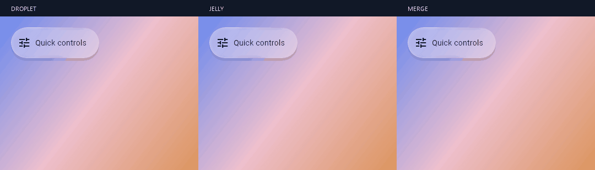
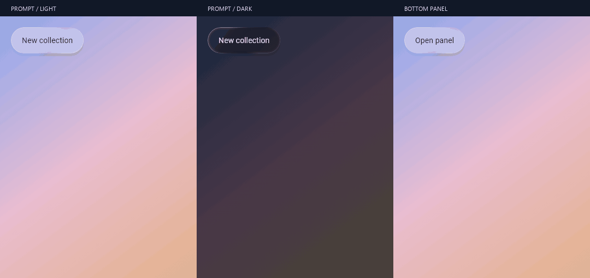
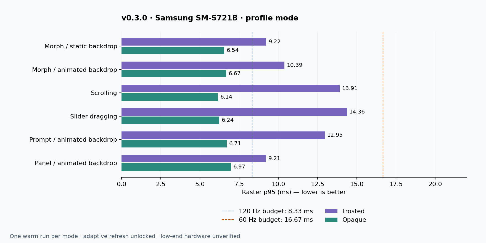

# liquid_ui_components

Liquid glass for Flutter: surfaces, controls, navigation, draggable blending,
fluid morphs, alerts, prompts and panels. Share one material theme, then choose
optical, frosted or opaque rendering for your screen.

[pub.dev](https://pub.dev/packages/liquid_ui_components) ·
[API & migration guide](doc/API_GUIDE.md) · [Changelog](CHANGELOG.md) ·
[Android frame times](doc/PERFORMANCE.md) · [Screenshot gallery](doc/SCREENSHOTS.md)



**Droplet · Jelly · Merge.** Actual v0.3.0 component captures in Frosted mode,
composed side by side. GIF playback illustrates motion; it is not measured device FPS.
[Static alternative](screenshots/v0.3.0/morph-styles.png).

## Install

```sh
flutter pub add liquid_ui_components
```

```yaml
dependencies:
  liquid_ui_components: ^0.3.0

flutter:
  uses-material-design: true
```

```dart
import 'package:liquid_ui_components/liquid_ui_components.dart';
```

Requires **Flutter 3.44+ / Dart 3.12.2+**. Release checks use Flutter 3.47.5 /
Dart 3.13.4. **Android** is the declared and device-tested platform; iOS, web and
desktop have not been validated. This is a Flutter interpretation of liquid
glass, not a native UIKit material. No host shader registration or permissions
are needed. The example app requires Flutter 3.47.5 / Dart 3.13+.

## What's included

| Feature | API | Behavior |
| --- | --- | --- |
| Shared material | `LiquidGlassTheme`, `LiquidGlassSettings` | Global settings, per-widget overrides, light/dark theme inheritance, Regular/Clear presets. |
| Surfaces | `LiquidGlassSurface` | Content-sized glass, optional custom shape, crisp foreground, directional rim and exterior shadow. |
| Actions | `LiquidGlassButton`, `LiquidGlassIconButton` | Keyboard/focus support, tooltips, disabled states and liquid press feedback. |
| Toolbars | `LiquidGlassToolbar` | Wrapping controls on a shared surface. |
| Segments | `LiquidGlassSegmentedControl<T>` | Controlled single selection with a moving glass pill. |
| Sliders | `LiquidGlassSlider` | Filled track, held glass thumb, optional icon, divisions, RTL, native value semantics. |
| Switches | `LiquidGlassSwitch` | Slim track, expanding held thumb, native toggle input; scrolling cancels hold feedback. |
| Navigation | `LiquidGlassNavigationBar`, `LiquidGlassNavigationItem` | Spring selection, badges, hold/drag preview, RTL, optional scroll compaction. |
| Blending | `LiquidGlassBlend`, `LiquidGlassBlendItem` | Two droplets or a keyed builder/list; drag, fuse, split, mixed corner radii and per-item actions. |
| Morphing | `LiquidGlassMorph`, `LiquidGlassMorphMotion` | Droplet/Jelly/Merge, reversible expansion, persistent shared title, optional overlay and pull gestures. |
| Touch dynamics | `LiquidGlassDynamics` | Shared press, stretch, highlights and spring release, with adjustable intensity. |
| Notifications | `LiquidGlassToast` | ScaffoldMessenger queuing, Undo/custom actions, persistence, swipe and close handling. |
| Alerts | `LiquidGlassAlert`, `LiquidGlassAlertTone` | Inline info/success/warning/error announcements, optional action and dismissal. |
| Prompts | `LiquidGlassPrompt` | Typed custom dialogs and confirmation results with liquid entrance/exit. |
| Panels | `LiquidGlassPanel` | Reusable settings/form cards and keyboard-aware modal bottom panels. |
| Scrolling | `LiquidGlassScrollEdge`, `LiquidGlassScrollEdgeStyle` | Soft or pinned edge separation beneath floating controls. |
| Scroll behavior | `LiquidGlassScrollBehavior` | Scroll behavior without a stretching edge decoration. |
| Accessibility | Shared settings and native semantics | Reduced motion, high contrast, explicit Reduce Transparency, focus and keyboard input. |

[Detailed examples, parameters and limitations for every component →](doc/API_GUIDE.md)

## Choose a rendering mode

| Mode | Setting | Appearance and tradeoff |
| --- | --- | --- |
| Full refraction | `LiquidGlassRendering.automatic` | Live background bending, magnification and chromatic dispersion. Shader-filter support required. |
| Balanced | `LiquidGlassRendering.balanced` | Real refraction without chromatic dispersion. Not a blur-only or guaranteed-fast mode. |
| Frosted | `LiquidGlassRendering.frosted` | Blur, tint and rim lighting without background distortion. The gallery default. |
| Opaque | `LiquidGlassRendering.solid` | Solid material, readable foreground, no backdrop blur/refraction. Start here for constrained hardware. |

Unsupported optical backends fall back to frosted rendering. High contrast and
`reduceTransparency: true` force opaque surfaces. Reduced motion disables
decorative dynamics/transitions; shared surfaces also avoid optical effects.
Settings default to the stable backend (`liquid_glass_easy`, validated at 3.3.1).
The package-owned `experimentalNative` renderer is opt-in and retains unresolved
flicker reports; it is not the recommended release path.

`blur` softens the background; `opacity` controls tint, not child transparency.
Refraction/depth/magnification affect optical modes. Blending `viscosity` controls
optical thickness, not drag speed. Use `settings` overrides on components;
navigation names its override `glassSettings`.

## Quick start

```dart
import 'package:flutter/material.dart';
import 'package:liquid_ui_components/liquid_ui_components.dart';

void main() => runApp(const GlassDemo());

class GlassDemo extends StatefulWidget {
  const GlassDemo({super.key});
  @override
  State<GlassDemo> createState() => _GlassDemoState();
}

class _GlassDemoState extends State<GlassDemo> {
  double volume = 0.6;
  bool enabled = true;

  @override
  Widget build(BuildContext context) => MaterialApp(
    theme: ThemeData(colorSchemeSeed: const Color(0xff62518a)),
    home: LiquidGlassTheme(
      settings: const LiquidGlassSettings(
        rendering: LiquidGlassRendering.frosted,
      ),
      child: Scaffold(
        body: Container(
          decoration: const BoxDecoration(
            gradient: LinearGradient(
              begin: Alignment.topLeft,
              end: Alignment.bottomRight,
              colors: [Color(0xff90a7ef), Color(0xffe9bdd1), Color(0xffe4b28d)],
            ),
          ),
          child: Center(
            child: Padding(
              padding: const EdgeInsets.all(24),
              child: LiquidGlassPanel(
                title: 'Quick controls',
                icon: Icons.tune_rounded,
                child: Column(
                  mainAxisSize: MainAxisSize.min,
                  children: [
                    LiquidGlassSlider(
                      value: volume,
                      semanticLabel: 'Volume',
                      thumbIcon: Icons.volume_up_rounded,
                      onChanged: (value) => setState(() => volume = value),
                    ),
                    LiquidGlassSwitch(
                      value: enabled,
                      semanticLabel: 'Audio enabled',
                      onChanged: (value) => setState(() => enabled = value),
                    ),
                  ],
                ),
              ),
            ),
          ),
        ),
      ),
    ),
  );
}
```

Place glass over real content or artwork: a flat background has little detail
to blur or refract. Application state stays controlled by your callbacks;
the example's volume control does not change system audio.

## Alerts, prompts and panels



The modal surface follows the droplet perimeter with restrained, staggered
damped springs. Text keeps its final layout while it reveals; closing reverses
the motion. Reduced motion and zero dynamics disable the effect. Presentation
recordings use Frosted rendering and are separate from Android timing tests.
[Static alternative](screenshots/v0.3.0/modal-transitions.png).

```dart
final confirmed = await LiquidGlassPrompt.confirm(
  context,
  title: 'Create collection?',
  message: 'Keep your favorite discoveries together.',
  confirmLabel: 'Create',
);
// true: confirmed; false: cancelled; null: dismissed.
```

Use `LiquidGlassPrompt.show<T>(context, builder: ...)` for a custom form and
`LiquidGlassPanel.show<T>(context, builder: ...)` for a bottom panel. Pop with
`Navigator.pop(builderContext, result)` to return a typed result. Helpers capture
the call site's glass settings. Own text controllers inside a stateful prompt
so they survive the closing route transition.

```dart
LiquidGlassAlert(
  title: 'Saved locally',
  message: 'Your changes will sync when you reconnect.',
  tone: LiquidGlassAlertTone.info,
);
```

## Android frame times and low-end compatibility

**Low-end Android hardware is not verified.** The available device was a
Samsung SM-S721B, Android 17/API 37, 1080 × 2340. Results use Flutter 3.47.5
**profile mode**, adaptive refresh unlocked, USB charging, and warm device
conditions around 40 °C. One sequential run per mode is evidence for this
workload/device, not a frame-rate guarantee or controlled before/after comparison.



| Scenario | Frosted avg / p95 | Opaque avg / p95 |
| --- | ---: | ---: |
| Morph / static | 6.93 / 9.22 | 5.08 / 6.54 |
| Morph / animated | 7.58 / 10.39 | 4.83 / 6.67 |
| Scrolling | 11.31 / 13.91 | 5.17 / 6.14 |
| Slider | 12.43 / 14.36 | 4.89 / 6.24 |
| Prompt | 7.81 / 12.95 | 4.83 / 6.71 |
| Bottom panel | 6.26 / 9.21 | 5.17 / 6.97 |


All durations are raster-stage milliseconds. Build and raster are pipelined;
do not add them or interpret reciprocal stage time as delivered FPS. **60 Hz**
allows **16.67 ms** per stage; **120 Hz** allows **8.33 ms**. Inspect tail latency,
not averages alone. No consistent 120 fps claim is made. Full/Balanced and the
experimental backend were not benchmarked in the release runs.

[Full UI/raster p90/p95/max, frame counts, budget exceedances, source fingerprint,
conditions and reproduction commands →](doc/PERFORMANCE.md)

For constrained devices, begin with Opaque; try bounded Frosted surfaces only
after profiling. Reduce blur and overlapping filters, pause animated backdrops,
and share `BackdropGroup` only among nonoverlapping siblings. Held slider/switch
thumbs can use Balanced optics in Frosted mode; use Opaque to avoid this cost.
There is no automatic hardware-tier detector. Expose a quality option and test
the actual low-end devices you intend to support.

## What's new in v0.3.0

- Themed alerts, typed prompts and modal panels, with fluid open/close transitions.
- Multi-item blending and shared fusion outlines in Frosted/Opaque modes.
- Slim slider/switch tracks, expanding held thumbs and scroll-cancel behavior.
- Exterior-only shared shadows to avoid backdrop brightness jumps during scrolling.
- Correct selected navigation icon layering in Frosted/Opaque modes, including badges.
- Navigation release settles toward the destination; drag shadows stay with the contour.
- Stable renderer adapter, explicit experimental backend, profile tooling and documented limits.

[Full changelog](CHANGELOG.md) · [Migration from 0.1/0.2](doc/API_GUIDE.md#migration)

## Run the gallery and checks

```sh
git clone https://github.com/veha2309/liquid_ui_components.git
cd liquid_ui_components
flutter pub get
flutter analyze
flutter test
cd example
flutter pub get
flutter run --profile
```

The Android runner is included. The gallery demonstrates every component, dark
mode, quality settings and interactive blending. Backdrop artwork and the
favorite heart burst are example-only implementations. The gallery runs without
unpublished tooling; optional `ui_tester` workflows live in a separate development
package described in [example/UI_TESTING.md](example/UI_TESTING.md).

- [Every public feature and parameter](doc/API_GUIDE.md)
- [Screenshots and GIF recording](doc/SCREENSHOTS.md)
- [Benchmarks, budgets and low-end guidance](doc/PERFORMANCE.md)
- [Rendering architecture and experimental limits](ARCHITECTURE.md)
- [Report an issue](https://github.com/veha2309/liquid_ui_components/issues)

MIT licensed. See [LICENSE](LICENSE). Inspired by liquid-glass visual materials;
this package is not affiliated with Apple.
