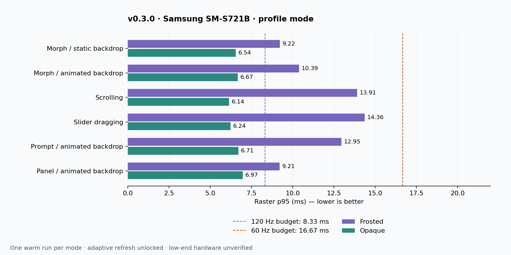

# Android frame times and compatibility — v0.3.0

Measured on **Samsung SM-S721B**, Android 17/API 37, Flutter 3.47.5 stable /
Dart 3.13.4, **profile mode**, 1080 × 2340, on 4 November 2026.
Adaptive refresh was not locked. USB charging; observed temperatures around
40 °C. These are sequential single warm runs, not a controlled comparison.

**Low-end Android compatibility is unverified.** No low-end phone was available.
The results describe this device and gallery workload only. The 60 Hz budget is
16.67 ms and the 120 Hz budget is 8.33 ms **per pipelined UI/raster stage**.
Passing an average budget alone does not establish smooth delivery; inspect
p95, maxima and exceedance counts too. No sustained 120 fps claim is made.



## Frosted

| Scenario | Frames | UI avg | UI p95 | Raster avg | Raster p95 | Raster max | Raster >16.67 ms | Raster >8.33 ms |
| --- | ---: | ---: | ---: | ---: | ---: | ---: | ---: | ---: |
| Morph / static backdrop | 1,344 | 1.55 | 5.38 | 6.93 | 9.22 | 17.84 | 2/1344 | 583/1344 |
| Morph / animated backdrop | 1,268 | 1.56 | 5.33 | 7.58 | 10.39 | 19.11 | 2/1268 | 614/1268 |
| Scrolling | 699 | 1.43 | 4.38 | 11.31 | 13.91 | 18.69 | 1/699 | 684/699 |
| Slider dragging | 634 | 1.48 | 3.04 | 12.43 | 14.36 | 72.51 | 1/634 | 632/634 |
| Prompt / animated backdrop | 1,030 | 1.28 | 3.19 | 7.81 | 12.95 | 21.03 | 3/1030 | 349/1030 |
| Panel / animated backdrop | 1,115 | 1.26 | 3.08 | 6.26 | 9.21 | 12.47 | 0/1115 | 135/1115 |

All durations are milliseconds. [Full JSON, p90/p95/max and total-span timings](performance/v0.3.0/2026-11-04-sm-s721b-frosted.json).

## Opaque

| Scenario | Frames | UI avg | UI p95 | Raster avg | Raster p95 | Raster max | Raster >16.67 ms | Raster >8.33 ms |
| --- | ---: | ---: | ---: | ---: | ---: | ---: | ---: | ---: |
| Morph / static backdrop | 1,382 | 1.19 | 3.90 | 5.08 | 6.54 | 10.60 | 0/1382 | 14/1382 |
| Morph / animated backdrop | 1,384 | 1.14 | 3.80 | 4.83 | 6.67 | 10.61 | 0/1384 | 20/1384 |
| Scrolling | 957 | 1.06 | 3.21 | 5.17 | 6.14 | 8.92 | 0/957 | 1/957 |
| Slider dragging | 936 | 0.89 | 1.82 | 4.89 | 6.24 | 11.03 | 0/936 | 9/936 |
| Prompt / animated backdrop | 1,127 | 0.98 | 2.10 | 4.83 | 6.71 | 9.73 | 0/1127 | 9/1127 |
| Panel / animated backdrop | 1,133 | 0.92 | 2.07 | 5.17 | 6.97 | 10.73 | 0/1133 | 20/1133 |

All durations are milliseconds. [Full JSON, p90/p95/max and total-span timings](performance/v0.3.0/2026-11-04-sm-s721b-solid.json).

## Choosing settings for constrained devices

Start with `LiquidGlassRendering.solid` for the smallest backdrop workload.
Try Frosted on small, bounded surfaces if blur matters; reduce `blur`, avoid
overlapping filters, and pause animated backgrounds. Use `BackdropGroup` only
for nonoverlapping siblings. Reserve Full/Balanced optical refraction for compact
controls after profiling on your target GPU. There is no automatic hardware-tier
detector; select settings explicitly and provide an Opaque option.

```dart
LiquidGlassTheme(
  settings: const LiquidGlassSettings(
    rendering: LiquidGlassRendering.solid,
    dynamicsIntensity: 0.5,
  ),
  child: MyAppContent(),
)
```

Reduced motion disables decorative transitions. High contrast and the explicit
Reduce Transparency bridge force opaque surfaces. Test both steady scrolling
and held/dragged controls; a cheap idle scene can still have expensive interaction
frames. Android is the declared platform; iOS, web and desktop remain unvalidated.

## Method and limits

The integration binding runs `fullyLive`, allowing intermediate frames between
actions. Two warm-up morph/prompt/panel cycles precede six measured open/close
cycles. Scroll and slider tests warm the renderer and use repeated timed drags.
Wait/settle frames are included; numbers are scenario-level distributions, not
isolated transition-only costs. Static morph measurement pauses the backdrop;
other scenarios retain the gallery's animated backdrop. Frosted hold feedback
can use Balanced optics on the small slider/switch thumb.

Native `FrameTiming` callbacks supply build, raster and total-span durations.
UI and raster are pipelined: do not add averages, calculate displayed FPS from
their reciprocals, or call exceedance counts dropped frames. Different sample
counts can reflect display scheduling; they do not imply equal-workload FPS.
Thermals, charging, background processes, refresh adaptation and gallery layout
affect results. Full/Balanced and experimental-native quality were not measured
in these release runs. Earlier failed harness runs were discarded.

The JSON reports contain a SHA-256 of the library and shader source. Historical
investigations remain in [the versioned archive](performance/v0.3.0/README.md)
and are not evidence of an improvement over this release.

## Reproduce on your own device

From `example/` with an unlocked Android device, repeat for each mode:

```sh
flutter drive --profile --driver=test_driver/performance.dart --target=integration_test/glass_performance_test.dart --dart-define=GLASS_PERFORMANCE_QUALITY=frosted -d DEVICE_ID
flutter drive --profile --driver=test_driver/performance.dart --target=integration_test/glass_performance_test.dart --dart-define=GLASS_PERFORMANCE_QUALITY=solid -d DEVICE_ID
```

Set `GLASS_PERFORMANCE_REPORT` to separate output paths for each run; by default
the driver writes `example/build/glass_performance.json`. Record temperature,
charging, OS, SDK, renderer and refresh policy; repeat several runs on actual
low-end hardware before making a compatibility claim. Do not capture screenshots
or screen recordings during the measurement. To rebuild this document and chart
from the release report paths, run `python tool/summarize_release_performance.py`
(requires matplotlib).
