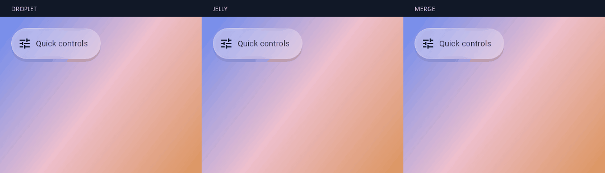
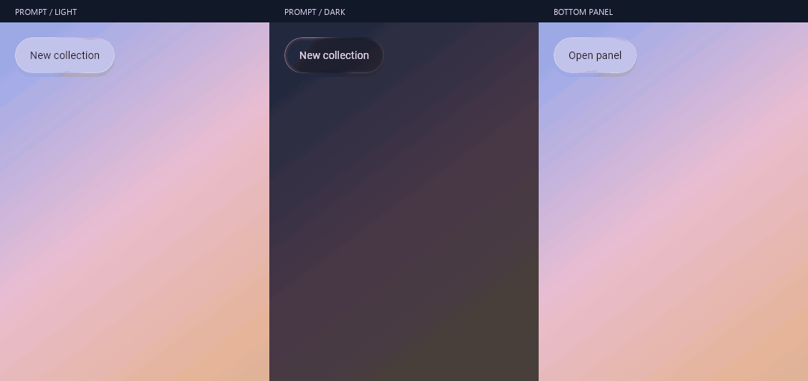
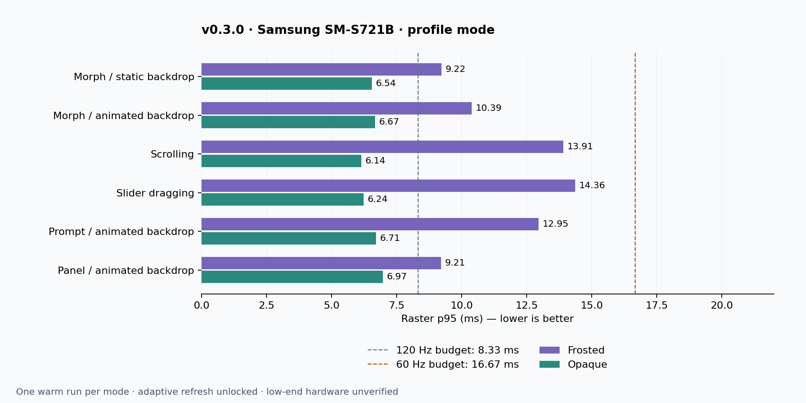

# v0.3.0

Liquid glass alerts, typed prompts and modal panels join the controls, navigation,
blending and morphing toolkit. This release also fixes shared backdrop shadows,
scroll feedback, drag trails and selected navigation icon visibility.



## New and improved

- **Alerts:** info/success/warning/error, adaptive status colors, live announcements,
  optional action and accessible dismissal.
- **Prompts and panels:** confirmations, custom forms, typed results, content-sized
  cards and keyboard-aware bottom panels. Restrained liquid transitions preserve
  text layout and respect reduced motion.
- **Morphs:** Droplet, Jelly and Merge, reversible springs, shared content,
  floating expansion and hold/pull interaction.
- **Blending:** bounded multi-item builder/list, mixed corner radii, keyed position
  retention and shared smooth-union Frosted/Opaque contours.
- **Controls:** slim slider/switch tracks with accessible hit targets, expanding
  held thumbs, shared press dynamics and scroll cancellation.
- **Navigation:** spring settling toward the released destination; icons/badges
  stay above Frosted/Opaque selectors and remain optical input for refractive lenses.
- **Rendering:** shared exterior shadows prevent self-shadow capture/brightness
  changes during scrolling; moving Frosted/Opaque blend shadows follow the contour.
- **Release tooling:** reproducible device screenshots, component GIFs, profile
  reports, API/migration documentation and a portable example without local tooling.



## Measured Android performance

Two profile runs on Samsung SM-S721B, Android 17/API 37, Flutter 3.47.5 stable,
1080 × 2340; adaptive refresh unlocked, USB charging, warm conditions around
40 °C. Frosted and Opaque are measured separately. Reports include UI and raster
average/p90/p95/max, frame counts, total span, budget exceedances and a source hash.



**Low-end Android compatibility remains unverified.** These sequential warm runs
do not certify other devices, establish sustained 120 fps or measure delivered
FPS. UI/raster stages are pipelined; exceedances are not OS-presented dropped-frame
counts. Full/Balanced and the experimental backend are not benchmarked in these
release runs. Start with Opaque on constrained hardware, then profile Frosted
and any held optical controls on target GPUs.

## Install and compatibility

```yaml
dependencies:
  liquid_ui_components: ^0.3.0
```

Flutter 3.44+ / Dart 3.12.2+ declared minimum; release checks use Flutter 3.47.5 /
Dart 3.13.4. Android is the declared platform. iOS, desktop and web remain
unvalidated. Stable rendering is the default; `experimentalNative` remains opt-in
with unresolved flicker reports. The gallery starts in Frosted mode.

## Validation and assets

- 105 package/widget tests passed; Flutter analyzer clean.
- Android profile benchmark passed all six scenarios for both quality modes.
- Android release screenshot integration passed; nine device captures supplied.
- Component GIFs are deterministic UI captures, separate from performance testing.

The attached screenshot ZIP includes the device gallery and presentation media.
JSON attachments contain the measured frame-time summaries and conditions.

[Feature/API guide](https://github.com/veha2309/liquid_ui_components/blob/v0.3.0/doc/API_GUIDE.md) ·
[Performance report and reproduction](https://github.com/veha2309/liquid_ui_components/blob/v0.3.0/doc/PERFORMANCE.md) ·
[Screenshot gallery](https://github.com/veha2309/liquid_ui_components/blob/v0.3.0/doc/SCREENSHOTS.md) ·
[Changelog](https://github.com/veha2309/liquid_ui_components/blob/v0.3.0/CHANGELOG.md) ·
[pub.dev](https://pub.dev/packages/liquid_ui_components/versions/0.3.0)
