# v0.3.0 visual guide

The Android captures below come from the release gallery on a Samsung SM-S721B
in profile mode, 4 November 2026. Images are resized from 1080 × 2340 to
720 × 1560. No mock controls or simulated screenshots are substituted.

## Motion comparisons

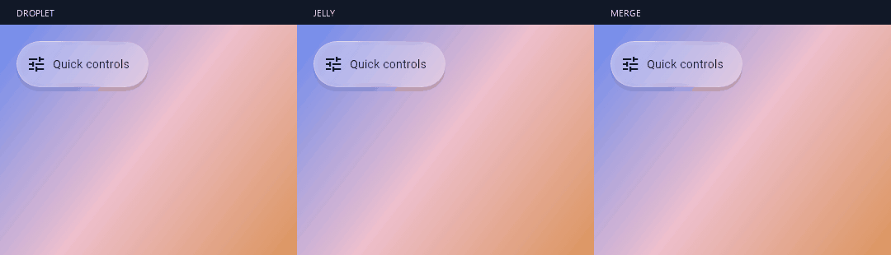

This triptych uses deterministic Flutter widget captures on the same gradient
background, matching each motion's elapsed time. It demonstrates the actual
component's open/close behavior; its encoded playback is not a device FPS test.
[Static alternative](../screenshots/v0.3.0/morph-styles.png).

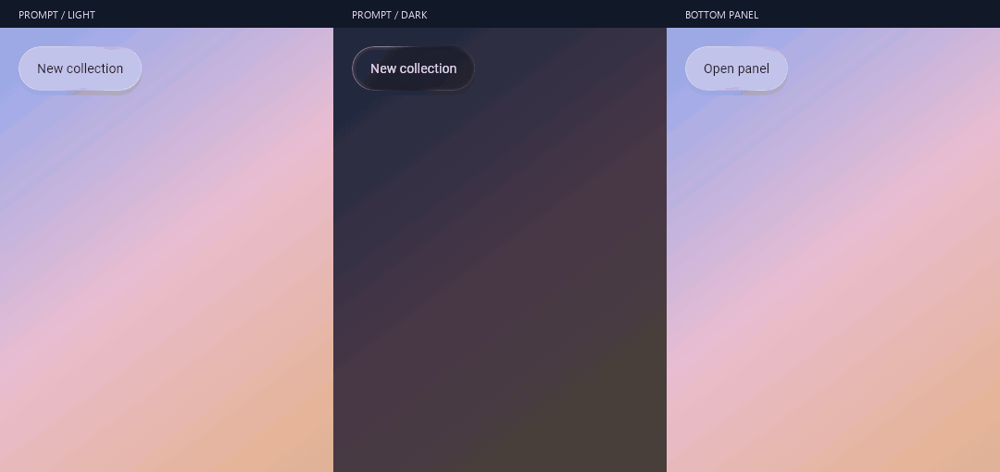

These prompt/panel frames are also deterministic Flutter captures, with matching
elapsed-time samples across the three scenes. [Static alternative](../screenshots/v0.3.0/modal-transitions.png).
Run `flutter test tool/capture_modal_previews.dart --dart-define=FLUTTER_SDK=YOUR_SDK`
before the media composition script to reproduce them.

## On-device gallery

| Controls, light | Controls, dark | Expanded morph |
| --- | --- | --- |
| 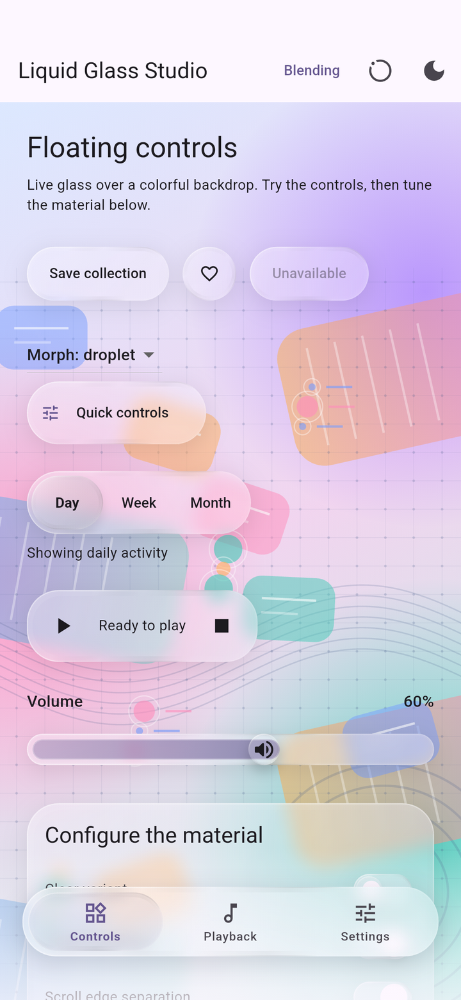 | 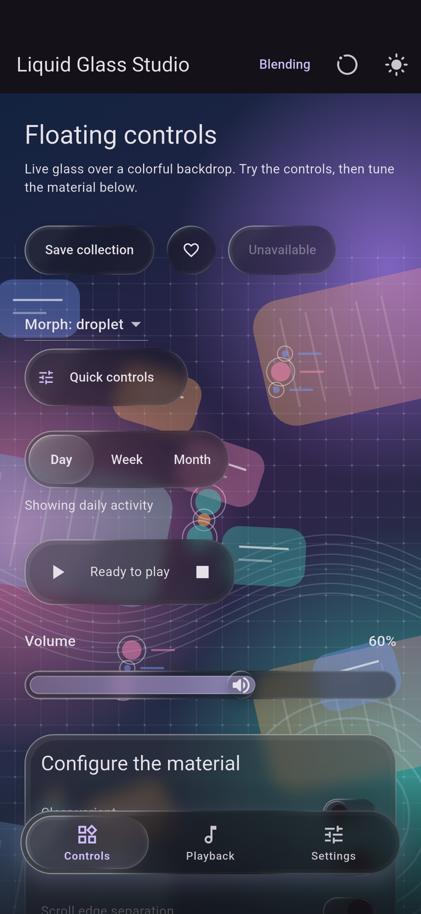 | 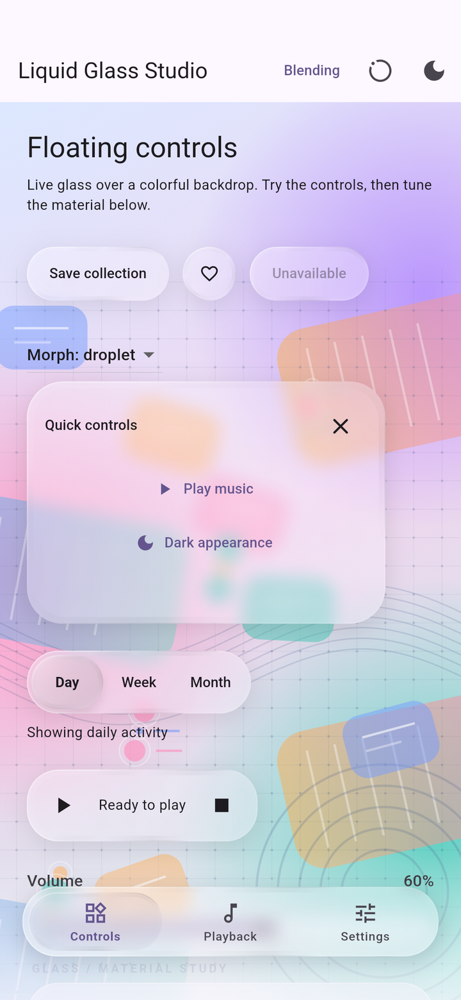 |

| Sliders and settings | Multi-item blending | Alerts and panels |
| --- | --- | --- |
| 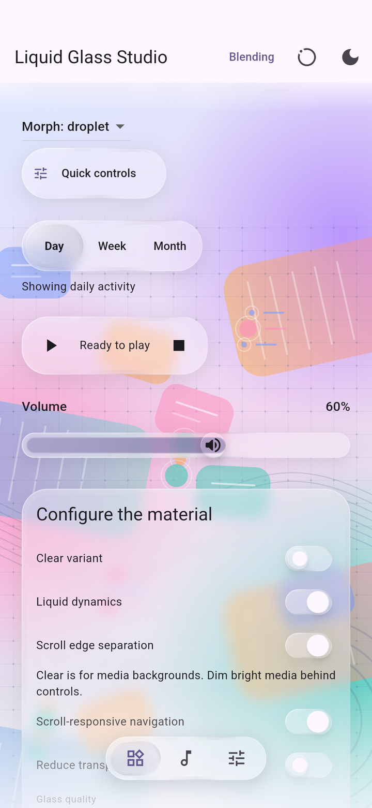 | 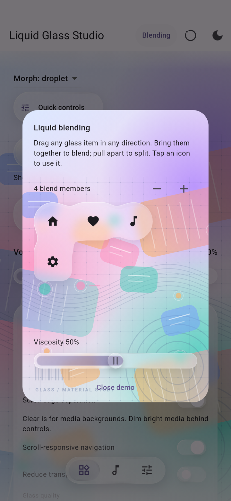 | 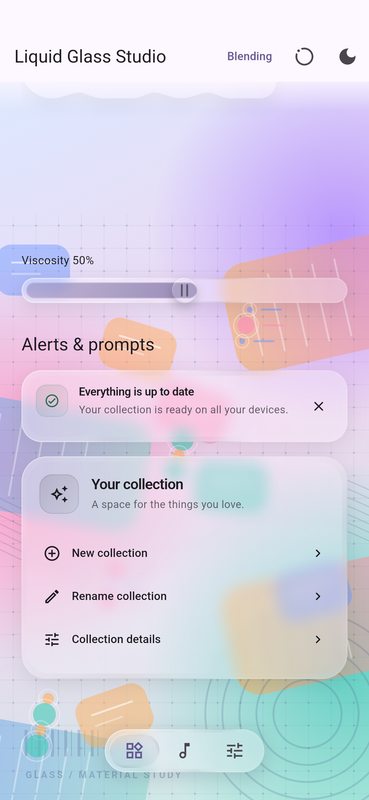 |

| Confirmation | Confirmation, dark | Bottom panel |
| --- | --- | --- |
| 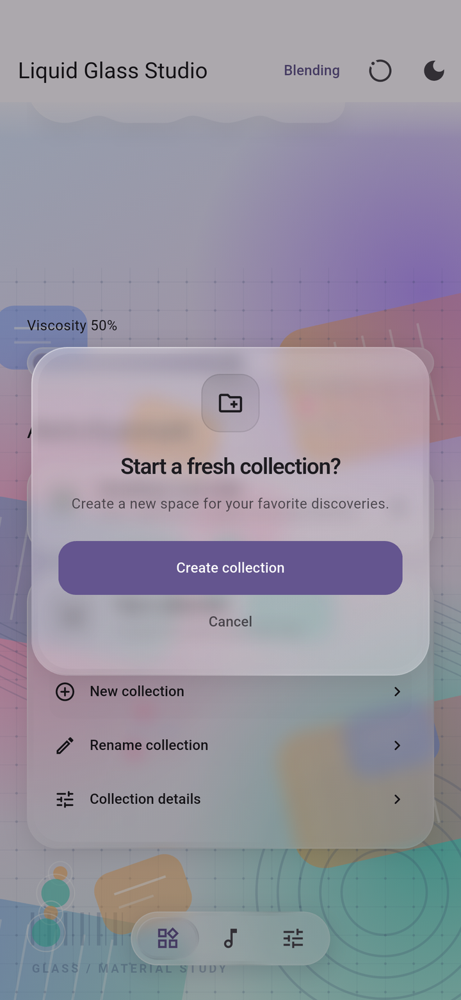 | 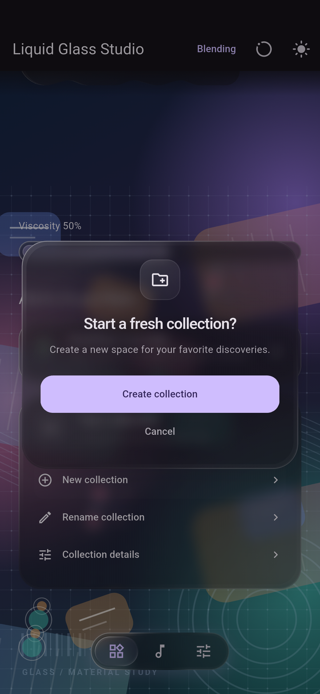 | 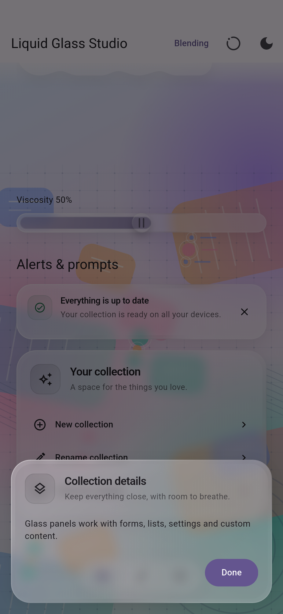 |

## Reproduce

From `example/`, with an Android phone connected:

```sh
flutter drive --profile --driver=test_driver/release_screenshots.dart --target=integration_test/release_screenshots_test.dart -d DEVICE_ID
```

Output: `example/build/release-screenshots/`. Screenshot readback can stall the
GPU and is deliberately run separately from [frame-time measurements](PERFORMANCE.md).

For the triptych, run the opt-in `render fluid morph progression` test with
`CAPTURE_GLASS_MORPH=true`, each `MORPH_MOTION` value, and `FLUTTER_SDK` pointing
to your SDK. Then run `python tool/make_release_media.py` (requires Pillow).
